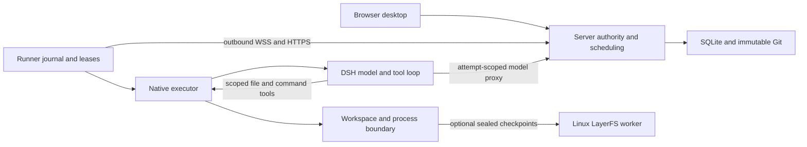
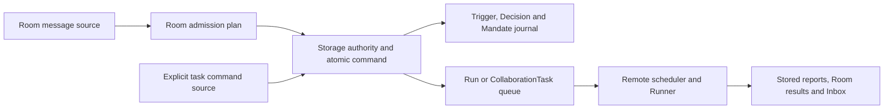

# Camp architecture

The [native Runner contract](native-runner.md) owns platform-specific isolation, workspace and checkpoint boundaries. The shared Server/Runner protocol and persistence rules below apply to both Linux and Mac ARM64.

Camp has one trusted team's single Server, React desktop and independent Linux and Mac ARM64 Runners. The [Server composition](../apps/server/internal/server/server.go) uses `remoteruns`; it never starts the legacy local Run scheduler or a DSH/LayerFS bridge. SQLite and immutable Git objects own shared results; workspace and checkpoint backends do not authorize publication.

Server owns identity/permissions, admission/scheduling, model proxy, durable files, review and notifications. Model bootstrap and settings/readiness views belong to `configuration`; optional document workers own their Node/runtime paths. The Server startup lock is acquired before migrations and keeps the historical `runs/.lock` path, independently of the local regression executor. Runner actively connects to Server and owns its journal, deduplication, local scheduling, lease watchdog, reconnection reconciliation and artifact upload/cleanup. Native executor prepares tools, calls DSH and checks/exports results without the business database. DSH owns the model/tool loop. The workspace backend is LayerFS on Linux or a native local directory on Mac; cleanup and recovery follow the native Runner contract. Even on one machine, Server and Runner are separate processes using the same remote protocol. Server has no Agent-execution dependency on host Docker, DSH or LayerFS.

The [root Go entrypoint](../main.go) is the thin command required by `go install github.com/cofy-x/camp@<version>`. CLI handling and platform process handoff live with the [release launcher](../internal/launcher/entrypoint.go), outside the Server's internal packages. The launcher installs the exact published Server or Runner archive and replaces itself with that executable, preserving process signals and exit status. It owns only a private, rebuildable version cache, never team configuration, credentials or Runner journals. This preserves the complete generated Dashboard and compiled-in runtime identities without checking generated bundles into source or rebuilding release metadata during `go install`. Standalone archives remain the offline path; source developers retain `make build`.

Keep these authority boundaries stable as implementations change. Workspace, sandbox, process and checkpoint adapters are composed behind the [native contract](native-runner.md); their different capabilities do not create another source of publication authority. Add an abstraction when it has a distinct owner and an actual caller, and preserve the same journal, permission and recovery guarantees across adapters.

## Package boundaries

| Owner | Responsibility |
| --- | --- |
| [Platinum](../packages/platinum/src/types.ts) | App-independent windows, controls, icons, menus and keyboard/pointer behavior |
| [Dashboard app](../apps/dashboard/src/app/App.tsx) | Providers, startup, shared desktop data and application registry |
| [Features](../apps/dashboard/src/features) | Application definitions, views, scoped styles and focused tests |
| [Shared](../apps/dashboard/src/shared) | Generic HTTP/session and interaction helpers |
| [team](../apps/server/internal/team) / [configuration](../apps/server/internal/configuration) | Authentication and private versioned administrator settings |
| [collaboration](../apps/server/internal/collaboration) | Membership, explicit message admission and evidence preparation |
| [orchestration](../apps/server/internal/orchestration) | Source-event vocabulary, pure Room admission planning and task decision classification; no storage or executor dependency |
| [eventflow](../apps/server/internal/eventflow) | Bounded, tool-free event assessment and external-delivery workers; storage owns every admission and effect transition |
| [remoteruns](../apps/server/internal/remoteruns) | Admission, scheduling, model proxy, transport and publication |
| [runnerprotocol](../apps/server/internal/runnerprotocol) | Versioned, storage-independent machine wire types |
| [daemon](../apps/server/internal/daemon) | Outbound connection, durable inbox/outbox, authorization watchdog and retained uploads |
| [nativeexecutor](../apps/server/internal/nativeexecutor) | Pinned native execution, checks, export and cleanup; no storage/Room dependency |
| [Fixture executor](../apps/server/internal/daemon/fixture_tasks.go) | Deterministic scenarios using the same daemon protocol, journal and recovery lifecycle |
| [runinput](../apps/server/internal/runinput) | Bounded conversation context, frozen task briefs and immutable reference preparation through read-only interfaces |
| [runs](../apps/server/internal/runs) | Local execution regression harness; production code does not import it |
| [serviceowner](../apps/server/internal/serviceowner) | Single Server/offline maintenance owner using the retained directory lock |
| [dsh](../apps/server/internal/dsh) / [execution](../apps/server/internal/execution) | Public DSH protocol/overlays, Bubblewrap boundary and process ownership |
| [layerfs](../apps/server/internal/layerfs) / [sandboxexec](../apps/server/internal/sandboxexec/README.md) | SDK bridge, Docker operations and trusted nonroot container helper |
| [runnertools](../apps/server/internal/runnertools) / [workspace](../apps/server/internal/workspace) | Run-scoped file/command capabilities and replaceable workspace lifecycle/capture contracts |
| [serverstorage](../apps/server/internal/serverstorage) | Stopped Server inventory, portable identity-bound orphan maintenance and recoverable receipts; no model/service authority |
| [resources](../apps/server/internal/resources) / [library](../apps/server/internal/library) | Safe ingestion, immutable Git bytes and human publication using writer leases |
| [documents](../apps/server/internal/documents) / [documenttext](../apps/server/internal/documenttext) | Durable text-preparation queue, fixed runtime verification and isolated bounded Linux/Mac parsers; no Runner/model authority |
| [storage](../apps/server/internal/storage) | Persistent business invariants and atomic state changes, including authority/version checks at commit |
| [httpapi](../apps/server/internal/httpapi) | Protocol parsing, request bounds, authentication integration and status mapping |

Features must not import the application registry or startup implementation. Keep file browsing, editing and publication in `features/library`; keep reusable resource transport with its API models and generic transport in `shared`. Platinum must not know Camp application IDs: use host callbacks for system actions and `AppDefinition.launchable` for launcher visibility. Removing an app should require no desktop-package changes. Add a layer only when it has a distinct owner. Validate transport, archive and execution inputs at their owning boundaries; storage rechecks the business authority and versions required for atomic publication.

Remote execution and the local regression harness share `runinput` directly. It reads visible history and immutable evidence from admitted records without creating an execution manager or granting authority. Callers own prepared reference directories, including partial results after an error, and retain their existing cleanup lifecycle. Task briefs use the round's frozen input revision; admission and publication remain transactional storage responsibilities.

Server storage deliberately uses one SQLite connection on local disk, with WAL, foreign keys and `synchronous=FULL`. Reads and writes share that connection, so transaction callbacks must stay short: model/network calls, document extraction and Git/filesystem work happen outside business transactions. Mutations recheck current authority and frozen versions at commit; related protected reads use a single read snapshot. Write transactions acquire `BEGIN IMMEDIATE`; only lock acquisition retries, within the caller's context and a five-second ceiling. A transaction callback is never replayed. Waiting for the connection also observes caller cancellation. Runner journals have their own single connection and reapply their durability and foreign-key settings whenever a connection is replaced. [Installation](install.md#data-upgrades-and-backup) owns coordinated backup and restore of the database and its associated files.

Register apps with `AppDefinition` and use shared desktop navigation, dialogs, menus and close guards. Refactors preserve observable behavior; intentional product changes update callers, tests and contracts together. Keep React Hook dependencies complete and handle asynchronous failures. Fix lint findings without blanket suppressions.

## Event admission and orchestration

Camp separates intake decisions from execution. The [orchestration policy](../apps/server/internal/orchestration/policy.go) resolves selected and mentioned Room Agents and enforces their combined limit for both readiness preflight and transactional admission. Preflight grants nothing. Storage rereads membership and current authority, freezes the actual grant and writes the [admission journal](../apps/server/internal/storage/orchestration.go) in the same transaction as the Message, Run/Task queue, receipt and notifications. A failed journal write rolls back the command; a failed command leaves no journal entry. External work begins only after commit through the existing remote scheduler. Task decisions classify commands after the task state machine has checked authority and applied the operation; they do not provide a second authorization or scheduling engine.

The two built-in Sources use trusted application metadata. A Room event points to its immutable Message. A task event identifies the authenticated actor, command scope and request ID through a stable hash, and points to its task and any original input Message. New records retain the original receipt's scope, request ID and canonical content hash, plus the task revision and input frontier accepted by that command. The receipt reference locates the original result after later task changes; a hash alone is not a readable source reference. Task IDs select input destinations explicitly; ordinary Thread discussion has no implicit subscription and never resumes work. Task inputs and answers are context under the existing grant, even when an answer schedules the next round. Only task start and explicit continuation record task Mandates. Cancellation records a stop decision. Task state, input batching and round scheduling remain with their existing owners.

Each accepted Room event records one Mandate summary per Run. Each task start/continuation records its approved participant revisions, Runner routes, access, Resource, shared baseline and finite allowance. Task baseline references remain protected by the stopped storage catalog. Ordinary Run baselines are still chosen at writer-lease acquisition, so their admission summaries do not invent a baseline. A Mandate is immutable admission evidence, not an execution credential or a second authority store. Current permissions and the owning Run/Task still control execution, model access and publication. Continuation appends a new snapshot; it never rewrites the original. The policy version identifies the deterministic rule implementation, independently of Agent, model or permission revisions.

The architecture follows the separation of concerns in the [dsh-superagent research prototype at reviewed commit 6337fc8](https://github.com/deepseek-ai/dsh-superagent-prototype/tree/6337fc823ce20251c8de8085948165c81aaa701e), adapted to Camp's team and publication model:

| Prototype concept | Camp implementation |
| --- | --- |
| Source / Trigger | Room discussion and authenticated GitHub observations in a unified immutable event log; explicit Room/task admission retains its existing journal |
| Gate / Eval / Decision | Deterministic source/actor/policy gates, bounded model assessment and transactional decisions; explicit commands keep their existing state-machine checks |
| Mandate | Admission evidence referring to the existing finite Run/Task authority |
| Ticket | CollaborationTask for persistent goals; an independent Run for a single request |
| Assignment / Executor | Run round, Attempt, frozen Agent/Runner target and native executor |
| Subscription / Input | Context-only fan-out from followed source Threads to active tasks and the existing append-only input log |
| Effects / recovery | Durable evaluation/delivery records plus the existing Run queue, Attempt commands, Runner journal and completion receipts |
| Channel / Outbox | Atomic Room completion Messages and Inbox; optional durable ordinary GitHub comments with uncertain-delivery recovery |

[GitHub observation](github.md) provides a separate, signature-authenticated ingress adapter. It commits the source-scoped receipt, immutable original and normalized source event before any asynchronous assessment. Explicit human confirmation and automatic admission contend on the same immutable external event decision. Manual confirmation retains the confirming member as requester; an automatic task records the policy's authorizing member without attributing external text or system messages to that member. Task creation, frozen inputs, subscription, finite grant and first Run commit together through the existing task owner. Execution still uses the existing Runner scheduler.

### Event automation

Each Room/source has one versioned administrator policy: disabled by default, with observation or automatic admission, rules, allowed immutable actor IDs, approved participants/routes and finite daily/task allowances. Room members and GitHub actors remain separate identities. Saving a policy establishes a new intake frontier; changing from observation to automatic admission never executes earlier observations. Reading/configuring automation starts no model request. Enabled policies may assess later ordinary discussion; explicit human Agent requests retain their existing Run path and supply context to existing subscriptions without another assessment. **Post only** bypasses both assessment and subscription delivery.

A saved policy is team configuration. Changing its author's administrator role does not implicitly disable it; every new action still requires that enabled member's current Agent, Resource and Runner execution permissions. Disabling the member or revoking those permissions prevents new authorization. Policy management continues to require a current administrator.

Storage ingests each normalized event once and independently fans it out to followed active tasks as context. Subscription never expands authority, consumes ownership of a new request, wakes a completed task or answers a human question implicitly. Several tasks can follow the same Thread. Late inputs belong to the next frozen round; the existing input coverage/publication checks remain authoritative. A finished task needs a new request and new authorization. External input attribution retains source/actor identity and never impersonates a Camp member.

Disabling an originating policy pauses that source's automatic input to its tasks. An explicitly added subscription to another enabled source remains governed by its own source and the existing task grant, rather than an unrelated policy's enabled flag.

Cancellation closes that task's subscriptions at their committed event boundaries. When no other active task follows the Thread, earlier pending events are retired so a stopped goal cannot restart from its backlog. Another active subscription keeps the shared Thread's events available for assessment; cancellation never consumes that task's context. Any in-flight assessment must still pass its frozen task-frontier check before authorizing work.

The event worker claims a frozen batch with one evaluation per source Thread, policy/model revisions, related task frontier and a charged daily assessment slot before model access. New arrivals wait for another batch. The [bounded assessment](dsh.md#event-assessment) has no tools, filesystem, Runner or execution authority. Completion rechecks policy revision, event ownership, task frontier, current source/member/participant authority and the daily task limit. A stale or incomplete outcome remains visible as needs attention; it never silently spends another model allowance. Auto acceptance creates at most one finite CollaborationTask per batch. Observation stores the assessment without execution.

Automatic task admission also appends a system-attributed record to the existing orchestration journal in the same transaction. It references the frozen assessment, policy revision and source events and uses the same Mandate builder as explicit task starts. The authorizing member remains separate from the system actor; historical missing records are not reconstructed.

Task questions, actionable failures and final results can atomically queue immutable ordinary GitHub comments when the policy permits them. Private comment credentials and webhook secrets have separate immutable files outside team SQLite. The sender rechecks source, current task authority, comment permission and credentials before claiming work. Unknown POST outcomes permit read-only marker/body/actor reconciliation; absence never proves non-delivery. Further reconciliation and possible duplicate resends are explicit recoverable commands. Restart marks interrupted assessments unavailable and reconciles interrupted sends without replaying their model request or POST. The [GitHub workflow](github.md#automated-work-and-replies) and [automation API](api.md#event-automation) own the public controls.

The prototype's policy changes and automatic resume rules do not override Camp's immediate permission revocation or finite grants. Runner source-directory imports are a separate model-free capture operation, not event Sources.

The journal starts at its additive migration. Historical Messages, Run snapshots and task receipts stay unchanged; old grants, missing receipt metadata and decisions are not invented during upgrade or replay. Reads use the [bounded journal API](api.md#orchestration-journal). Records contain references and grant summaries rather than source text, instructions, model configuration or credentials. No retention or automatic deletion is implemented.

## Team and authority

A Room holds team-visible discussion and Agent members; its primary Resource holds shared working files. A Thread is anchored to an existing Message. An Agent is a persistent identity and permission set. A Run is one explicit Agent request, with an AgentConversation scoped to Agent × Room/Thread. Personal editing drafts, Inbox, reads and layouts belong to the authenticated person. Collaboration task drafts are team-visible, but do not change shared Room files until final publication.

| Identity | Meaning |
| --- | --- |
| User | Team member and attributed actor |
| Agent | Persistent role, responsibilities and permissions |
| Runner | Registered execution machine with stable private storage |
| CollaborationTask | Goal, approved participants, finite grant, draft and progress |
| Run | One Agent execution, independently requested or one task round |
| Attempt | Actual execution authorization/lifecycle for that Run |
| SourceImport | Separate model-free source-capture operation |

Personal ownership does not create private Rooms or task results.

[Ownership and routing](../apps/server/internal/storage/ownership.go) distinguish invocation from management. Members create personal Agents and Runners. Owner/admin controls changes to owned objects and Agent sharing; enabled members can join team-owned Agents, while removing one requires an administrator. Automatic Room setup only shares team-owned defaults. Sharing an Agent into a Room lets teammates invoke it, without granting machine management or source-directory access.

Personal Agents keep their selected Runner. Team Agents use explicit Agent target, then Room route, then team default. A personal default is copied into new personal Agents, not consulted anew for each Run. Admission freezes the actual target and configuration; offline/busy Runners wait without reassignment. Permission revocation marks queued/active work and waiting tasks durably. Restoring permission cannot revive revoked work. Admission, model access and publication recheck authority.

## File and publication ownership

Uploaded originals are immutable and require an explicit working copy for edits. Runner imports retain an immutable initial commit and directly create a new working Resource. Later execution never writes back to the source directory. Source aliases are operator-approved, not browser-supplied host paths. Capture checks file identity and two manifests but is not an atomic filesystem snapshot; quiesce a source when that guarantee is required.

Ordinary writers acquire one durable, fenced Resource lease before choosing their latest baseline. Manual save and restore use the same lease and expected-revision compare-and-swap (CAS). Waiting writers consume no execution slot; read-only work can use stable snapshots concurrently. Server concurrency and Runner slots are configured independently. Each Agent executes eligible requests in admission order across Rooms and frozen Runner targets: an older queued request keeps its place while its Runner is unavailable. Cancelling or revoking that queued request releases its successor. Other Agents remain independent. Defaults belong in [execution configuration](dsh.md#configuration-and-budgets).

A cleaned Sandbox export remains untrusted until Go validates entry types, paths, byte limits and digest. Git stores immutable bytes first. The final SQLite transaction validates Attempt, owner/fence, baseline and current permissions, then commits the Resource pointer, terminal Run, unique completion Message, publication, receipt and Inbox notification together. A failed final transaction cannot claim success. Idempotent upload/completion can finish persistence without a model replay.

Immutable exports verify the registered snapshot ref and tree, then read blobs in one isolated `git cat-file --batch` process. They stream one bounded file at a time in sorted path order, preserve executable modes and deterministic archive bytes, and enforce per-file and aggregate limits even when paths share an object. Readers do not hold the mutable resource lock while writing archives. Cancellation or output failure kills and drains the child before returning; callers retain their temporary-file, fsync, digest and activation checks.

Successful writing requires configured checks to pass. No checks is `not_configured`; human publications are `not_run`. Tool read-back or model claims are not independent checks. Failure/cancellation can retain confirmed captured files without publishing them. An unconfirmed export cannot be reconstructed from an unchanged host seed. Git/SQLite, not LayerFS checkpoints, are delivery authority. A crash between Git storage and SQL registration can leave unregistered objects. [Stopped Server storage](install.md#stopped-server-storage) owns bounded reference/space inspection and explicit orphan quarantine, restore and purge. Registered originals and history, including parser results stored in SQLite, remain protected without automatic expiration.

## Collaboration tasks

[Task storage](../apps/server/internal/storage/tasks.go) and [remote orchestration](../apps/server/internal/remoteruns/tasks.go) own a persistent goal, approved Agent/Runner snapshots, finite allowance, inputs/questions and an immutable draft chain. One task has at most one active round. Waiting consumes no Runner slot, model capability or shared Resource lease.

Storage owns the durable collaboration decision type and its [pure decision rules](../apps/server/internal/storage/task_policy.go). The remote result adapter explicitly copies Runner wire decisions into that model. Runner boundary validation remains separate from Server completion checks; current authority, budget, draft fencing and publication are rechecked within storage transactions. Wire and historical snapshot representations stay compatible.

Task rounds hold a task fence and advance only `checkpointCommit`. Handoffs and questions defer final checks. A writer finish validates checks and persists `publishing`, then briefly acquires the Resource lease and publishes only against `baseSharedCommit`. Accepted final checkpoints no longer need Runner connectivity. Shared edits during work leave the draft in `needs_attention`. Explicit continuation from latest files mounts the old draft as read-only evidence; no automatic merge or overwrite is allowed.

Task originals live in the append-only `task_inputs` log, with monotonically increasing task-local sequences. Camp-authored inputs retain their Message identity; source-event inputs have independent IDs and explicit message/source/actor provenance. Appending a human input, Room message, metadata and user request receipt is one transaction; source fan-out similarly commits its immutable event and inputs together. Task snapshots and new receipts store bounded metadata rather than copying the growing input log. Data-preserving migrations retain old originals, message links, order and receipt bytes; corruption rolls back the migration. Paginated reads and summary views are owned by the [task API](api.md#collaborations).

Execution starts consume rounds; each model request is reserved atomically before transmission. Unknown outcomes count and are not retried invisibly. Exhaustion requires another finite grant. Protocol-1 rounds freeze a contiguous interval after `coveredInputRevision`, capped at 64 KiB of whole originals encoded as JSON including escaping. The full goal and handoff remain separate. Both Room and Thread history exclude later task originals before their history limit, independently of the frozen message cutoff. Only an accepted successful round advances coverage; failures, cancellation, interruption and history reads do not. A finish with pending input schedules another finite round or retains `needs_attention`; publication rechecks coverage against the latest committed input frontier.

New writes explicitly opt into the bounded input protocol and summary responses; the Dashboard retains that choice with each pending request. Legacy body hashes, receipts and already frozen Runs keep protocol 0 and their original full-prefix semantics. New protocol admission removes the task-lifetime count/byte cap, retaining the 8192-byte per-original bound. Claim requires the assigned Runner to advertise `taskInputsVersion:1` before consuming a turn, Attempt or fence. An incompatible Runner leaves work queued for upgrade, without rerouting ordinary or legacy work. Protocol changes invalidate incompatible task sessions; an uncertain model request is never replayed to rebuild them.

During executing phase, the owning machine can retrieve one stable private read credential for that Attempt. Go retains it outside command/journal JSON and tool/command environments. Each Server read transaction verifies the credential, exact Attempt/Task, current permissions, Runner capability, task fence, lease/deadline and frozen input endpoint. Reads have the same 20-entry/64 KiB page budgets and cannot observe later inputs or other tasks. Cancellation, revocation, upload/finalization, termination and expiry deny further reads. The native coordinator exposes only `after`/`limit` on its existing private loopback service and closes reading before sealing a coordination decision, including a failed/uncertain seal. No command-network grant or extra sandbox port is added. Chat and task native sessions have separate scope keys.

Only task rounds expose structured handoff/question/finish tools. The private coordinator seals and drains workspace operations and journals a call-ID/body decision before acknowledging DSH. Intent alone cannot authorize recovery after process death; a complete retained result is required. Server alone schedules a successor and accepts publication. See [execution](dsh.md#collaboration-decisions).

## Remote execution and recovery

A Run is a request; its Attempt is the execution authorization. Connection epochs fence obsolete WSS connections without replacing Attempts or writer fences. WSS carries durable commands/events, ACKs, cancellation and lease grants. HTTPS carries immutable archives and the model proxy. No arbitrary port tunnel or shared Store is exposed. Machine credentials and browser sessions have separate boundaries; see the [API contract](api.md#daemon-protocol-v2).

Remote input preparation uses one bounded worker. The scheduler claims queued work only when that worker and existing execution capacity are available; waiting Runs reserve no new Attempt or writer lease. Eligible unsent Attempts retained after restart precede new claims. Claim freezes the native conversation identity with the existing baseline, task input/message cutoffs and fences. Preparation builds immutable files outside business transactions and outside reconciliation. The scheduler atomically rechecks current authority, deadlines, session/runtime identity and the ordinary writer or task draft fence before saving session metadata, manifests, one command and its capability hash. Read-only work retains its pinned version; a task checks the shared Resource CAS only during final publication.

The prepared command is retained across failed or lost activation replies; only a still-authorized unsent Attempt may rebuild input after restart. Scratch collection excludes an in-flight builder until it has actually returned, even when cancellation already committed. Shutdown cancels and drains builders before the Store or Server ownership closes. A builder never extends its original lease/deadline or dispatches work itself.

The opt-in [preparation probe](../apps/server/internal/remoteruns/preparation_measurement_test.go) measures warm synthetic storage/Git/fsync components, independently of native, provider, production or WSS latency. Archive throughput changes retain byte/mode/path/digest and publication checks; they do not increase worker concurrency.

Server persists commands before sending; daemon persists inbox before ACK and journal events/results before transmission. Identical replays return their original receipt; different content conflicts. This supports single publication, not exactly-once provider requests or external effects. Lease grants use the causal request's monotonic send time. Expiry stops execution; delayed grants cannot extend authorization from a newer heartbeat.

Brief WSS loss can preserve an Attempt while an independent model stream continues within its lease. Server restart interrupts a broken in-flight model stream without resending it. Daemon restart cleans incomplete execution and can upload a fully journaled result. Model access ends before the bounded upload phase. Cancellation persists intent and revokes model access first. Confirmed cleanup is Cancelled; uncertain cleanup is Interrupted and suspends the Runner in the same final transaction. Disabled Runners can retrieve terminal receipts; revoked credentials lose machine access.

[Native session eligibility](../apps/server/internal/nativeexecutor/executor.go) requires completed native work, acknowledged shutdown, normal exit and accepted Camp completion, plus matching Runner/storage/runtime/generation. Cancellation, missing state or uncertain exit invalidates resume. The next explicit request rebuilds bounded visible context and announces it; an uncertain prompt is never replayed automatically. File-version changes are announced without necessarily resetting context; Agent/resource/configuration changes can require a generation.

Server claims its ownership fence before migration/recovery. Each daemon owns its journal and bridge lock; startup resets only its private runtime home. Other Runners remain untouched. Server shutdown closes SSE/control streams and model streams, then drains HTTP and closes SQLite. Daemons enforce their own leases.

## Human review and delivery

[Review storage](../apps/server/internal/storage/reviews.go) owns actor permissions, optimistic revisions and transitions. HTTP checks immutable file existence before admission; the transaction rechecks the Resource pointer. A review pins one path and commit, names a requester/reviewer and creates one discussion Thread. Decisions, audit events, Messages, receipts and Inbox entries commit atomically and create no Runs. Execution success does not approve a document.

Only the enabled assigned reviewer approves or requests changes. Requester/admin resubmits, reassigns, cancels or delivers. Changing any shared file makes an unfinished review outdated because approval covers the complete Resource revision. Reassignment clears a decision; delivery requires current approved bytes. Delivered and cancelled reviews are terminal. Later file changes cannot alter delivery.

## Desktop state

The [registry](../apps/dashboard/src/app/registry.ts) composes five product apps, an About window and a development-only Gallery. Library is the sole file browser and text editor; Appearance is inside Settings. All apps share one React tree. The [team provider](../apps/dashboard/src/team/TeamContext.tsx) owns shared entities, reconnectable events, Inbox and unread state even while Workspace is closed. Typed navigation opens the exact destination in an existing window after draft-safe navigation. `lastMessageSeq` is a read position; `activitySeq` is an event cursor.

[Private drafts](../apps/dashboard/src/team/usePrivateDraft.ts) combine server CAS revisions with account-scoped local recovery. Closing, switching and sign-out flush drafts first; errors retain local content. A lost send response retains the original request body/ID. Deferred app navigation captures both its request order and Platinum's in-memory activation revision before flushing drafts. A newer navigation, window activation or window close cancels the old navigation after storage completes; it does not cancel or discard the private save. Delayed responses cannot mark newer text published or replace a newer destination. Hide/shade keeps app state mounted; pointer previews remain separate from committed layouts and pending saves retain ordering on failure.

The [Library controller](../apps/dashboard/src/features/library/useLibraryController.ts) owns reads, draft-safe transitions and editor cancellation for its mounted window. The [task controller](../apps/dashboard/src/features/collaboration/useTaskController.ts) owns collaboration reads, participant routing, mutations and session recovery. Their views render state and dispatch actions; request IDs and uncertain-write receipts stay with the controller. Each controller retains its own lifecycle instead of sharing a generic request state store.

Library consumes each navigation intent before dependent Room/list reads finish; explicit Room context is retained immediately and delayed data only resolves missing context. Loading/retry completion cannot replay navigation over a newer Sources interaction. Library freezes resource/path/baseline for an editor or review request. Obsolete reads cannot install another file after navigation. Existing filenames open saved bytes. Tabs preserve reading state; listing failures end loading and offer retry. Environment forms keep editing baselines separate from monotonically observed configuration revisions. Resource PATCH atomically compares the editing revision; a stale save cannot replace another administrator’s settings. A conflict preserves the draft and displays saved settings before an explicit keep/reload choice. Uncertain responses are read back without another write; if readback fails, the exact pending form remains frozen until verification. Configuration revisions are independent of file commits, and queued work retains its frozen environment.

## Readiness reporting

[Remote readiness](../apps/server/internal/remoteruns/manager.go) and [GettingReady](../apps/dashboard/src/features/settings/GettingReady.tsx) report configuration, prior provider responses, connected Runner self-test reports and recorded native task success separately. Refresh is a read-only GET, with its own timestamp; it preserves observation timestamps and makes no model call, dependency probe or admission change. Failed/obsolete refreshes retain the last accepted report without claiming fresh success.

Execution self-tests belong to explicit Runner setup, which owns the journal lock and confirms isolation/export/cleanup without a model request. Optional readers belong to document preparation and do not gate discussion/plain-text work. A future active probe needs an explicit owner, scope and protocol; a refresh cannot stand in for one. Readiness is an aggregate, not a guarantee of a particular Agent's routing, grants or future task outcome.

## Storage

[Numbered migrations](../apps/server/internal/storage/migrations) are the Goose schema; [named queries](../apps/server/internal/storage/queries) generate private sqlc rows. Business models/errors remain handwritten. Run `make generate` and `make generate-check` together with SQL changes and maintain generated Go source.

The current Team baseline upgrades through append-only migrations, retaining Rooms, versions, reviews and historical identity. Old Agent/Runner objects remain team-owned and historical local Runs get no synthetic Runner. Discarded pre-Team schemas fail with an explicit request for a new directory; they are not reset or backfilled automatically. A broken migration ledger is an error, not a clearing instruction. API compatibility for discarded development versions is unnecessary; existing team data still requires safe migration and a stopped backup.

Back up the entire stopped Server data directory, including Git and private model revisions. Runner identity, journal and native sessions have their own backup lifetime. [Installation](install.md#data-upgrades-and-backup) owns deployment, release integrity and restore procedure; [execution](dsh.md) owns native isolation and configuration. Source checks cannot establish native or real-model guarantees.

## Current implementation limits

The boundaries below describe current implementation choices, not permanent requirements for a particular schema, host platform or storage layout. Preserve the stated user guarantees when changing them. Open defects have separate work items below, with an owning module and observable completion conditions. Link an issue when one exists; remove resolved work items after updating the contract and its tests. Significant design rationale belongs with the owning contract.

| Boundary | Current implementation and guarantee to preserve |
| --- | --- |
| Source preservation | [FinishSourceImport](../apps/server/internal/storage/remote_sources.go) creates a working Resource/Room and retains its initial immutable Git commit in SourceImport. A second immutable-original Resource row is not required by this guarantee. Later edits preserve the captured source version and never modify the host directory. Capture's manifest checks are not an atomic filesystem snapshot. |
| Browsers select Runner source aliases | Runner import enforces this. A separate [Server import](../apps/server/internal/httpapi/rooms.go) still accepts an administrator-supplied host path through an operator allowlist; it is not unrestricted Runner browsing. |
| Prepared execution and checks | Production copies dependencies into the selected workspace and runs checks there: Linux LayerFS or a native Mac directory. Read-only dependency mounts and a separate disposable verification copy describe the Linux local regression harness, not production; see [project runtime](../tools/project-runtime/README.md). Preserve execution isolation and accurate check provenance when changing this layout. |
| Optional Mac checkpoint worker | The [worker adapter](layerfs-worker.md) retains a complete POSIX working-tree profile and requires independent LayerFS readback before publication. Its Disposable Store is separate from durable Server delivery. It requires an explicitly selected native ARM64 Linux engine, retains native captures and uncertain outcomes, and has no automatic fallback or model replay. UID/ACL/xattrs/times, special files and external hardlink groups are outside the declared profile. |
| Checkpoint retention | The [Mac storage lifecycle](install.md#inspect-mac-checkpoint-storage) reports bounded advisory usage and supports explicit quarantine, restore and permanent purge of unreferenced sealed captures. All operation-referenced history, prior Store epochs and native recovery remain protected. Quarantine retains bytes; no automatic history expiration or hard lifetime quota exists. |
| Upgrades preserve team data | Append-only Team migrations are implemented. [Migration validation](../apps/server/internal/storage/migrations.go) explicitly rejects discarded pre-Team baselines; there is no universal historical-data upgrader or automatic reset. Restore is the stopped manual procedure in [installation](install.md#data-upgrades-and-backup). |
| Event orchestration | Room/GitHub policies, bounded assessment, context subscriptions and ordinary GitHub comment delivery are implemented. GitHub history polling, Feishu, source plugins, automatic ended-task resume and general external actions remain outside this implementation. Preserve authenticated deduplication, finite grants, context-only routing and explicit uncertain-delivery recovery when extending it. |

Runner check/output reports assume a trusted machine; they are not remote attestation against a hostile operator. Source/browser/fixture results alone do not establish native isolation, fresh-host portability or real-provider success.

Address shared-data correctness and contradictions in the shipped workflow first, then use measurements to select checkpoint or lifecycle work. The items below own the remaining implementation work; release milestones and completed implementation sequences belong in retained evidence.

### Checkpoint cost and retention

Owners: `nativeexecutor` and `tools/layerfs-worker`. Small-file packing and bounded concurrent restore are implemented. Further optimization must use full checkpoint/unchanged/restore measurements, including required sealing and readback, rather than extrapolating a capture-only speedup. Preserve complete manifests, legacy captures, bounded work and observation after uncertain dispatch.

Explicit unreferenced-capture cleanup now has identity-bound recoverable plans and protects current generations, pending operations, reconstruction ancestry and stopped backups. Expiration of referenced checkpoint history still needs a separate ownership and ancestry contract; the soft storage budget does not authorize it. Runner identity/journals and durable Server results have separate lifetimes. Managed VM provisioning and automatic worker-image upgrade need their own lifecycle/compatibility design and actual acceptance before becoming supported features; they are not implied by a successful isolated VM benchmark.
